# FraudGuard AI — Pitch & Technical Presentation Deck

> **AI-Powered Fraud Detection & Smart Payment Assistant**  
> *A grounded, explainable digital payment safety assistant built with React 19, FastAPI, scikit-learn, and PayPal REST API.*

---

## Slide 1: Title & Executive Summary
- **Product Name**: FraudGuard AI
- **Tagline**: Transparent Anomaly Detection & Grounded Payment Safety Guidance
- **Mission**: Protect users from digital payment scams and high-risk transactions before funds leave their accounts, without opaque "black-box" decisions or hallucinated security alerts.
- **Key Differentiator**: Hybrid architecture combining instant rule heuristics with calibrated machine learning, coupled with a grounded plain-language assistant that turns reason codes into actionable verification steps.

---

## Slide 2: The Problem in Digital Payments
1. **Opaque Decisions**: Traditional fraud filters return binary approvals or blocks without explaining *why* a payment triggered suspicion.
2. **Alert Fatigue & Social Engineering**: Users often panic or bypass warnings because alerts do not give concrete, verified steps to confirm legitimacy.
3. **Black-Box AI Hallucinations**: Generic LLMs can hallucinate bank partnerships, claim false transaction statuses, or prompt users for sensitive secrets like OTPs and PINs.
4. **Pre-Authorization Gap**: Fraud checks frequently occur after authorization rather than pre-screening the intent at the payment gateway level.

---

## Slide 3: The Solution — FraudGuard AI
- **Transparent Multi-Signal Detection**:
  - Monitors 5 key signals: Amount variance, hour of day, novel device detection, location shift, and velocity attempts in a 10-minute window.
- **Hybrid Scoring Engine**:
  - Deterministic Rule Engine for instant high-risk policy enforcement (`UNUSUAL_AMOUNT`, `NEW_DEVICE`, `LOCATION_CHANGE`, `RAPID_ATTEMPTS`, `ODD_HOURS`).
  - Calibrated Machine Learning Classifier (`scikit-learn` Random Forest) predicting anomaly probability (0–100 scale).
- **Grounded Smart Assistant**:
  - Answers user queries strictly mapped to verified backend reason codes.
  - Zero hallucination: Never fabricates banking confirmations or asks for passwords, PINs, or OTPs.
- **Pre-Screening Payment Gateway (PayPal Integration)**:
  - Intercepts risky checkout attempts before order creation, allowing safe transactions while safeguarding anomalies.

---

## Slide 4: System Architecture

```mermaid
flowchart TD
    User([User / Browser])
    
    subgraph Frontend ["React 19 + Vite Frontend (Port 5173)"]
        UI_Dash["Screen A: Home Dashboard\n(KPIs & Score Distribution)"]
        UI_Form["Screen B: Check Transaction\n(Safe Input Fields & Presets)"]
        UI_Result["Screen C: Risk Result Card\n(Gauge, Badges & Reason Codes)"]
        UI_Assist["Screen D: Smart Assistant Modal\n(Grounded Explanations)"]
        UI_Hist["Screen E: History & Feedback\n(Persistent Audit Trail)"]
        UI_PayPal["Screen F: PayPal Gateway\n(Live Risk Pre-Screening)"]
    end

    subgraph Backend ["FastAPI Backend (Port 8000)"]
        Validate["Pydantic Input Validation\n(Bounded & Sanitized)"]
        Rules["Rules Engine\n(Transparent Reason Codes)"]
        ML["ML Pipeline\n(RandomForest Ensemble)"]
        Hybrid["Hybrid Threshold Policy\n(Low / Medium / High Band)"]
        AssistantEngine["Grounded Assistant Engine\n(Template-Grounded Responses)"]
        PayPalService["PayPal REST v2 Client\n(Sandbox Order & Capture)"]
    end

    subgraph Persistence ["Data & Model Storage"]
        SQLite[("SQLite Database\n(transactions & feedback tables)")]
        ModelFile[("model.joblib\n(Trained ML Classifier)")]
        MetricsFile[("model_metrics.json\n(Evaluation Report)")]
    end

    User --> UI_Dash
    User --> UI_Form
    User --> UI_PayPal
    
    UI_Form -->|POST /api/transactions/score| Validate
    UI_PayPal -->|POST /api/paypal/create-order| PayPalService
    UI_Hist -->|GET /api/transactions| Backend
    UI_Assist -->|POST /api/assistant/chat| AssistantEngine

    Validate --> Rules
    Validate --> ML
    ML --> ModelFile
    Rules & ML --> Hybrid
    Hybrid --> SQLite
    Hybrid --> AssistantEngine
    PayPalService --> Hybrid
    PayPalService -->|PayPal Sandbox API| PP_Cloud["PayPal Cloud Gateway"]
```

---

## Slide 5: The 5 Core Application Screens

### Screen A — Home Dashboard
- Real-time KPI summary: Demo Transactions Checked, High-Risk Alerts, Medium-Risk Alerts, Feedback Received.
- Risk distribution histogram (0–20, 20–40, 40–60, 60–80, 80–100) and risk tier breakdown.
- Recent activity log with one-click inspection.

### Screen B — Check Transaction
- Bounded numeric and toggle inputs (`amount`, `hour`, `new_device`, `location_change`, `transactions_last_10_min`).
- 4 instant test presets for testing (e.g. *Suspicious Midnight Burst*, *Normal Grocery*, *Rapid Carding*).

### Screen C — Risk Result Card
- 0–100 animated score gauge and multi-sensory risk band (icon + text + accessible color palette).
- Transparent reason-code tags (`UNUSUAL_AMOUNT`, `NEW_DEVICE`, `RAPID_ATTEMPTS`).
- Documented uncertainty banner: *"This is an automated demo risk estimate; it cannot confirm fraud."*

### Screen D — Grounded Smart Assistant
- Explains warnings using verified backend facts.
- Suggested prompt chips: *"Why was this flagged?"*, *"What should I check?"*, *"How do I report safely?"*
- Step-by-step verified action checklist for the user.

### Screen E — History & User Feedback
- Persistent SQLite table recording all evaluated demo transactions.
- Filter by risk level and feedback status.
- Inline feedback buttons (`Recognised`, `Not Recognised`, `Unsure`) enabling human-in-the-loop review.

---

## Slide 6: PayPal REST API Gateway Integration
- **Official PayPal v2 Orders Integration**: Direct connection with `api-m.sandbox.paypal.com`.
- **Pre-Screening Interceptor**:
  - Safe transactions (Low/Medium risk): Create official PayPal Order, return PayPal Order ID and approval URL, capture transaction.
  - Anomaly transactions (High risk): Automatically intercepted prior to order submission, warning the user and directing them to safety verification.
- **Dual Connection Modes**:
  1. *Interactive Sandbox Simulation*: Instant zero-config demo mode with pre-generated mock orders.
  2. *Live Developer Sandbox*: Configure any active PayPal Developer Client ID & Secret directly through the UI.

---

## Slide 7: Machine Learning Pipeline & Metrics

| Metric | Score | Industry Benchmark | Status |
|---|---|---|---|
| **ROC-AUC** | **0.9988** | > 0.90 | Excellent discrimination |
| **Recall (Sensitivity)** | **96.26%** | > 90% | Catches > 96% of fraudulent anomalies |
| **Precision** | **91.80%** | > 85% | Minimizes false positive customer friction |
| **F1-Score** | **0.9399** | > 88% | Balanced harmonic mean |

### Top Predictive Feature Importances
1. **Transaction Velocity (`transactions_last_10_min`)**: 34.2%
2. **Transaction Amount (`amount`)**: 30.6%
3. **Hour of Day (`hour`)**: 16.4%
4. **New Device Flag (`new_device`)**: 10.3%
5. **Location Change Flag (`location_change`)**: 8.5%

---

## Slide 8: Responsible AI & Security Safeguards
1. **No Real Money Movement in Prototype**:
   - Built strictly using synthetic data and PayPal Sandbox mode.
2. **Zero Credentials / Secret Leakage**:
   - Never asks for or stores UPI PINs, passwords, CVVs, card details, or OTPs.
3. **No Hallucinated Bank Claims**:
   - Grounded template-based assistant answers solely from backend-evaluated parameters.
4. **Human-in-the-Loop Feedback**:
   - Feedback is saved for demonstrative audit logs without assuming immediate truth.
5. **Prominent Prototype Disclaimers**:
   - Banner displayed across all views making prototype boundaries explicit.

---

## Slide 9: Future Production Roadmap
- **Phase 1 (Post-MVP)**: Integration with OAuth2 bank identity providers (Open Banking / Account Aggregator framework).
- **Phase 2**: Real-time behavioral biometrics (keystroke dynamics, pointer movement patterns).
- **Phase 3**: Federated ML model updates allowing privacy-preserving cross-merchant fraud intelligence.
- **Phase 4**: Automated compliance reporting (AML / PEP and PSD2 Strong Customer Authentication).

---

## Slide 10: Submission & Verification Summary
- [x] React 19 Frontend + FastAPI Backend running together seamlessly.
- [x] Input validation, risk scoring, and transparent reason codes verified.
- [x] Persistent SQLite database with transaction logging and feedback updates.
- [x] Model evaluation metrics and feature importances documented.
- [x] Official PayPal REST API v2 Orders integration and risk pre-screening tested.
- [x] Complete test suite passing with 100% test coverage.
- [x] UI screenshots and architecture diagrams packaged in repository.
