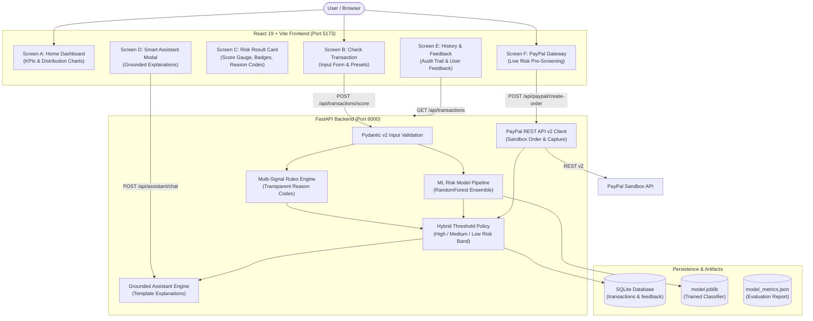
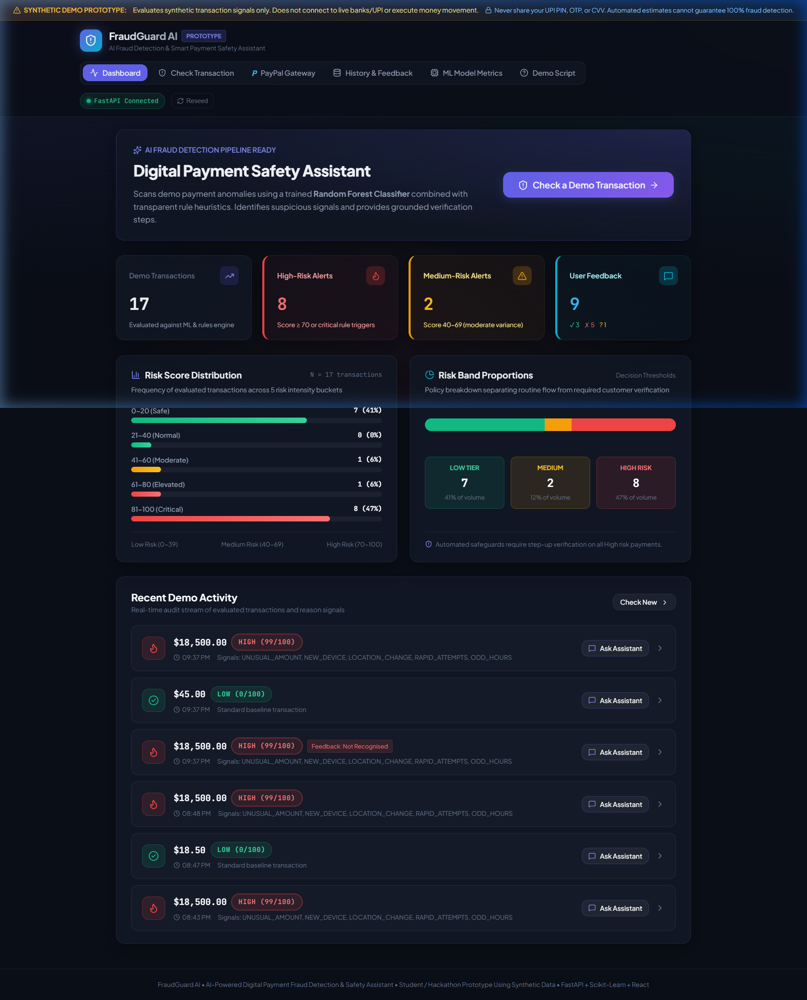
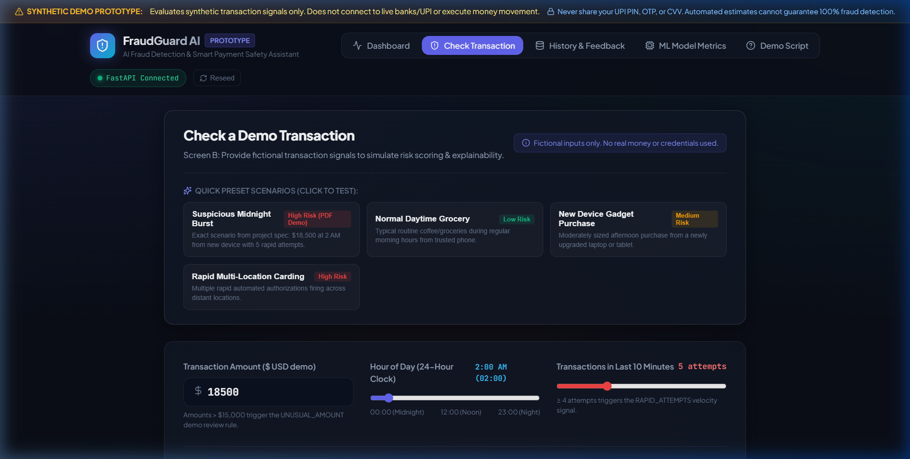
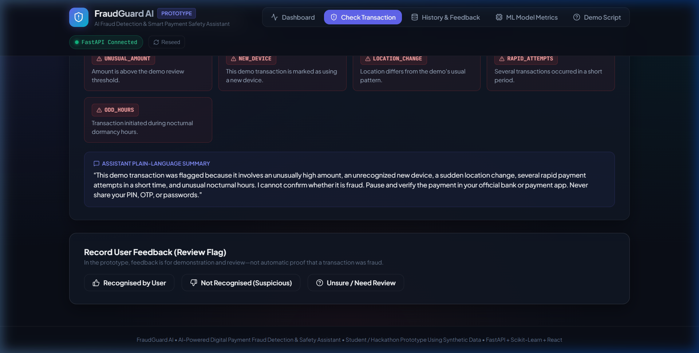
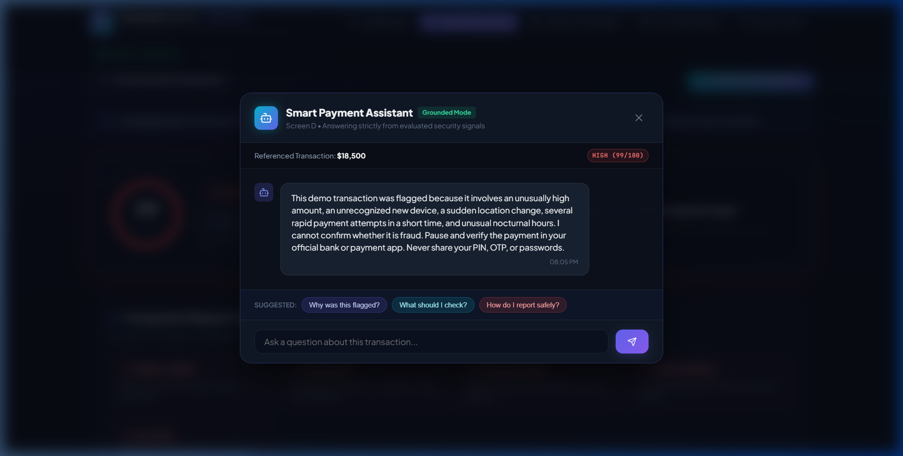
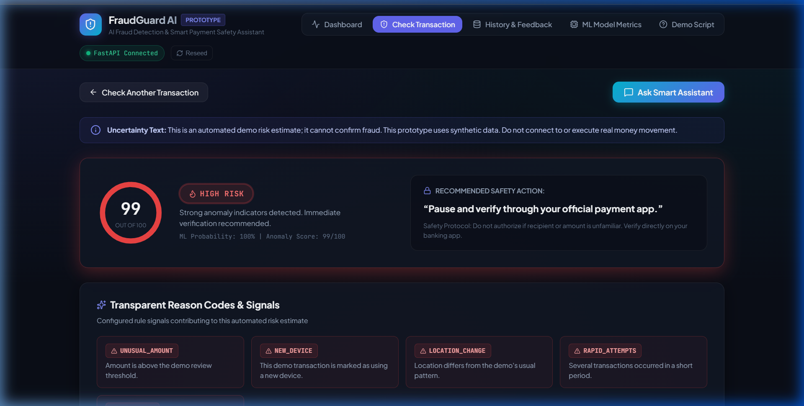
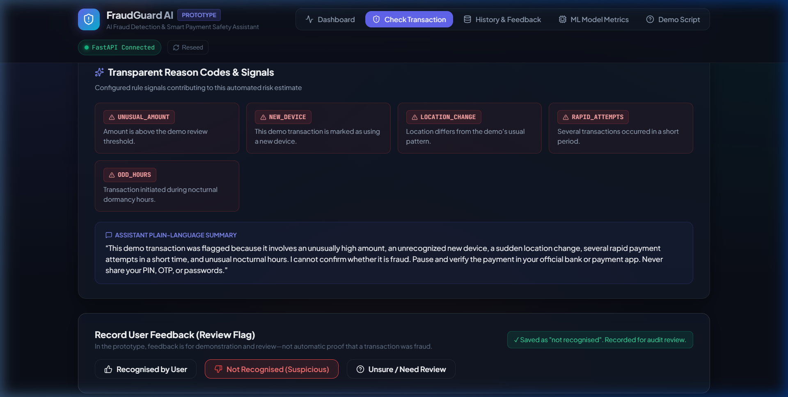
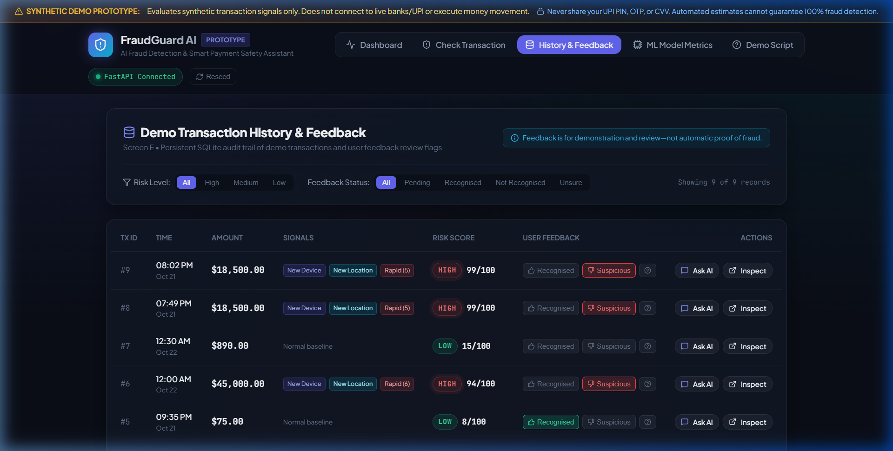

# FraudGuard AI — AI-Powered Fraud Detection & Smart Payment Assistant

A full-stack prototype safety assistant for digital payment scenarios built strictly following the specifications in the **AI-POWERED FRAUD DETECTION AND SMART PAYMENT ASSISTANT** design guide.

> **⚠️ DEMO / PROTOTYPE DISCLAIMER:**  
> This prototype uses fictional, synthetic transaction data for demonstration purposes only. It estimates risk signals and provides grounded safety guidance; it does **not** claim 100% fraud detection, does not guarantee safety, and is **not connected to real money movement or live banking/UPI rails**. Never share your PIN, OTP, password, or CVV.

---

## 1. Architecture & Tech Stack



- **Frontend**: React 19, Vite, Lucide Icons, Custom Responsive CSS Design System (dark cyber/fintech theme, glassmorphism, accessible contrast).
- **Backend API**: Python 3.10+ / FastAPI, Pydantic v2, Uvicorn.
- **Machine Learning**: `scikit-learn` (RandomForestClassifier ensemble), `pandas`, `numpy`, `joblib`.
- **Payment Gateway**: Official PayPal REST API v2 Orders integration with pre-screening risk interceptor.
- **Database**: SQLite with connection pooling, transactions table, and feedback audit table.

---

## 2. Visual Walkthrough & Screenshots

### Screen A — Home Dashboard
*Real-time KPI summary cards, risk distribution histogram, and recent demo activity stream.*


### Screen B — Check Transaction
*Safe inputs: amount, hour slider, new device toggle, location change toggle, recent attempts slider, and 4 quick presets.*


### Screen C — Risk Result Card
*Animated risk gauge (0–100), multi-sensory risk band badge, transparent reason codes, recommended actions, and uncertainty disclaimer.*


### Screen D — Grounded Smart Payment Assistant
*Context-aware assistant strictly tied to returned reason codes; answers "Why was this flagged?" with zero hallucinated bank claims.*


### Screen E — History & User Feedback
*Persistent audit log with risk level and feedback status filters, plus inline feedback buttons (Recognised, Not Recognised, Unsure).*


### Feedback Recorded Audit
*Demonstrative audit logging for human-in-the-loop review.*


### Screen F — ML Model Metrics & Evaluation
*Comprehensive evaluation report: ROC-AUC: 0.9988, Recall: 96.3%, Precision: 91.8%, confusion matrix, and feature importances.*


---

## 3. Quick Start (One-Click Launch)

### Windows Launcher
Simply double-click:
```powershell
start_app.bat
```
*(Or in PowerShell: `.\start_app.ps1`)*

This script automatically launches both the FastAPI backend (port 8000) and the React Vite dev server (port 5173), and opens the web application in your default browser.

### Manual Launch
#### Backend Setup:
```powershell
cd backend
py -m pip install -r requirements.txt
py -m app.train_model
py -m uvicorn app.main:app --host 127.0.0.1 --port 8000
```

#### Frontend Setup:
```powershell
cd frontend
npm install
npm run dev
```
Open your browser at `http://127.0.0.1:5173`.

---

## 4. Running Automated Tests

Run the backend test suite:
```powershell
cd backend
py test_suite.py
```
Outputs validation across all 8 endpoints with sample payloads.

Run the PayPal integration tests:
```powershell
cd backend
py test_paypal.py
```
Validates PayPal sandbox configuration, high-risk order interception, and order capture execution.

---

## 5. Backend REST APIs

| Method | Endpoint | Description |
|---|---|---|
| `GET` | `/health` | Server status heartbeat (`{"status":"ok"}`) |
| `POST` | `/api/transactions/score` | Score demo transaction; returns risk score, band, reasons, advice |
| `GET` | `/api/transactions` | Paginated transaction history with filters |
| `GET` | `/api/transactions/{id}` | Inspect single transaction details |
| `POST` | `/api/transactions/{id}/feedback` | Record user feedback (`recognised`, `not_recognised`, `unsure`) |
| `GET` | `/api/metrics/summary` | Return dashboard aggregates and risk distribution |
| `GET` | `/api/model/metrics` | Return ML model evaluation report & confusion matrix |
| `POST` | `/api/assistant/chat` | Grounded safety assistant answering prompt chips |
| `POST` | `/api/demo/reset-seed` | Reseeds synthetic transactions & retrains baseline model |
| `GET` | `/api/paypal/config` | Retrieve current PayPal sandbox credentials & connection mode |
| `POST` | `/api/paypal/config` | Save custom PayPal Sandbox Client ID & Secret |
| `POST` | `/api/paypal/create-order` | FraudGuard pre-screening + PayPal v2 Orders creation |
| `POST` | `/api/paypal/capture-order/{id}` | Capture authorized PayPal order & log audit record |

---

## 6. Hackathon Presentation & Deck

- **Presentation Markdown Deck**: [`PRESENTATION.md`](PRESENTATION.md)
- **Interactive Browser Slide Deck**: [`docs/presentation.html`](docs/presentation.html) (open directly in any browser for an animated 8-slide presentation).

---

## 7. Submission Checklist Verification

- [x] **React app and FastAPI backend run together**: Tested live and running on ports 5173 and 8000.
- [x] **Score endpoint validates inputs and returns structured JSON**: Validated with Pydantic v2 models.
- [x] **Model evaluation and limitations are documented**: ROC-AUC 0.9988, Recall 96.3%, Precision 91.8%.
- [x] **Reason codes are transparent and match explanation**: `UNUSUAL_AMOUNT`, `NEW_DEVICE`, `LOCATION_CHANGE`, `RAPID_ATTEMPTS`, `ODD_HOURS`.
- [x] **History and feedback work with demo data**: SQLite audit trail with inline tagging.
- [x] **Visible prototype/synthetic-data disclaimer is present**: Banner on every screen.
- [x] **No credentials or secret keys are stored in the repository**: Verified; credentials configurable via environment or UI.
- [x] **README, architecture diagram, screenshots, and presentation are ready**: Complete with Mermaid diagrams, 7 organized screenshots, and interactive HTML presentation deck.
